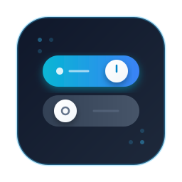
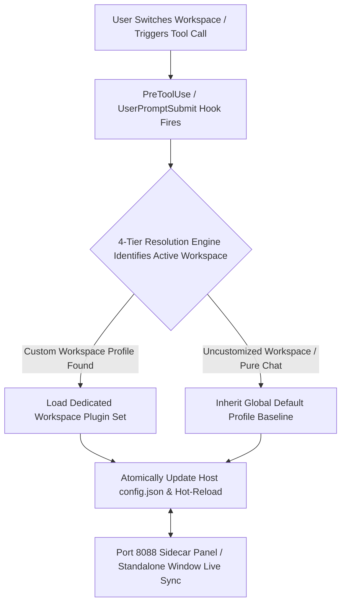

[English](README.en.md) | [简体中文](README.md)

<div align="center">
  
  <h1>Antigravity Plugin Switcher</h1>
  <p>
    <b>Per-Workspace Plugin Isolation & Live Toggle Console for Google Antigravity 2.0</b><br>
    Automatically switch active plugin sets per project with global baseline inheritance, inline batch editing, and standalone window control.
  </p>
  <p>
    <a href="https://antigravity.google/"></a>
    <a href="https://nodejs.org/"></a>
    <a href="docs/ARCHITECTURE.en.md"></a>
    <a href="LICENSE"></a>
    <a href="https://github.com/ToruOlenyeva/antigravity-plugin-switcher/stargazers"></a>
  </p>
</div>

> <b>Eliminate plugin bloat and context pollution</b>: Purpose-built for <b>Google Antigravity 2.0</b> (the parallel agent desktop application featuring the left-hand project tree and right-hand HTML Auxiliary Pane). Solve the critical issue where sharing a single global <code>config.json</code> across all projects and chat sessions wastes context window and tokens.

---

## ✨ Key Features

- <b>Project-Level Isolation</b>: Maintain independent plugin toggle profiles per workspace. Switching workspaces instantly switches active plugins, preventing irrelevant tools from polluting system prompts.
- <b>Global Default Baseline</b>: Set up a Default Profile inherited by all newly created or non-customized projects. Customized projects can be realigned with one click.
- <b>Chat Session Smart Isolation</b>: Detect directory-free chat sessions automatically and inhibit heavy development plugins to maximize response speed and prompt signal-to-noise ratio.
- <b>Inline Batch Editing</b>: Open batch edit mode directly inside the project selector dropdown. Support select all and multi-target selection to sync plugin toggles across multiple projects simultaneously.
- <b>Dual-Way Live Sync</b>: Seamlessly connect the Antigravity host native Settings and the Sidecar panel, synchronizing toggle states in real time regardless of where the modification occurs.
- <b>Standalone Window Mode</b>: Built-in fixed port 8088 web server allows direct control via an independent desktop app window, fully compatible with GCP remote login environments.
- <b>Bilingual Support and Theme Adaptation</b>: Automatically matches browser language preference on first load, native English and Chinese runtime localization with persistent storage, matching the host dark and light color systems automatically.

---

## 🔄 Core Workflow



---

## 🚀 Quick Installation

Built with native Node.js and <b>Zero Dependencies</b>. Clone and run immediately without executing <code>npm install</code>.

### 1. Clone into Antigravity Plugins Directory

<b>macOS / Linux</b>:
```bash
git clone https://github.com/ToruOlenyeva/antigravity-plugin-switcher.git ~/.gemini/config/plugins/plugin-switcher
```

<b>Windows (PowerShell)</b>:
```powershell
git clone https://github.com/ToruOlenyeva/antigravity-plugin-switcher.git "$env:USERPROFILE\.gemini\config\plugins\plugin-switcher"
```

<b>Windows (CMD)</b>:
```cmd
git clone https://github.com/ToruOlenyeva/antigravity-plugin-switcher.git %USERPROFILE%\.gemini\config\plugins\plugin-switcher
```

### 2. Enable and Launch

Restart Google Antigravity or enable the plugin in the Antigravity Plugins settings tab.

---

## 📂 Modular Project Structure

```
plugin-switcher/
├── assets/                      # Brand assets and vector logos
├── docs/                        # Deep technical architecture documentation
├── sidecars/
│   └── panel/                   # Native build-free decoupled Sidecar panel
│       ├── app.js               # Frontend interaction and state sync engine
│       ├── i18n.js              # Frontend internationalization dictionary
│       ├── index.html           # Frontend HTML skeleton structure
│       ├── ls-bridge.mjs        # Backend host RPC bridge and disk persistence
│       ├── main.mjs             # Backend HTTP routing and static server
│       ├── scanner.mjs          # Backend workspace scanner and 4-tier engine
│       ├── sidecar.json         # Sidecar container manifest
│       └── styles.css           # Responsive adaptive stylesheet
├── auto-switch.cjs              # Host lifecycle Hook interceptor
├── hooks.json                   # Antigravity Hook configuration
├── open-panel.bat               # Standalone window quick launcher script
├── plugin.json                  # Plugin manifest
├── project-plugin-profiles.example.json # Example profile configuration
├── README.en.md                 # English documentation
└── README.md                    # Chinese documentation
```

---

## 📖 Usage Guide

### 1. Workspace Profile Customization
Open the Project Plugin Switcher tab in the right Auxiliary Pane:
- The <b>green dot</b> on the right indicates the active project currently running in the host.
- The <b>blue checkmark</b> on the left indicates the profile currently being viewed and modified.
- Toggle any plugin card switch to apply changes immediately and notify the host language server.

### 2. Global Default Profile
- Select "Default Profile" at the top of the project dropdown.
- Configured plugin states act as the default baseline for all uncustomized projects.
- For projects with custom overrides, a "Reset to Default" button will appear, allowing one-click realignment with the baseline.

### 3. Inline Batch Edit
- Click the "Batch Edit" button on the top control bar to expand the dropdown menu.
- The top header displays a "Select All" checkbox alongside a live selected counter.
- Check target projects and flip any switch or reset to synchronize settings across all selected projects at once.

### 4. Standalone Window Mode (GCP Compatible)
When running without the Auxiliary Pane or inside remote cloud desktop sessions:
- Double click <code>open-panel.bat</code> in the plugin root folder.
- Or navigate to <code>http://127.0.0.1:8088</code> in any modern browser.
- The control console will launch in an isolated window with the identical experience.

---

## 📚 Documentation Matrix

| Module | Description & Technical Details | Link |
| :--- | :--- | :--- |
| <b>System Architecture</b> | Four-tier resolution algorithm, dual-way sync, hidden iframe observer guards, and API specs | [View Architecture](docs/ARCHITECTURE.en.md) |
| <b>Example Profile Configuration</b> | Standard JSON structure containing default profile and project overrides | [View Example Config](project-plugin-profiles.example.json) |

---

## 🤝 Contributors & Credits

- <b>[Toru Olenyeva](https://github.com/ToruOlenyeva)</b>
- <b>[Google Antigravity](https://antigravity.google/)</b>

---

## 📄 License

This project is licensed under the [<b>MIT License</b>](LICENSE).
