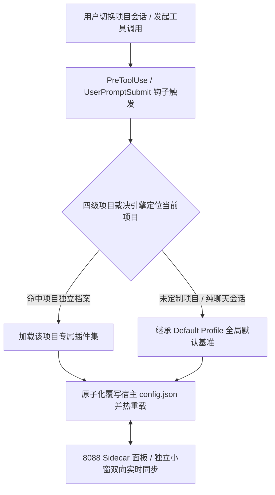

[English](README.en.md) | [简体中文](README.md)

<div align="center">
  
  <h1>Antigravity Plugin Switcher</h1>
  <p>
    <b>Google Antigravity 2.0 项目级插件独立隔离与热切换控制台</b><br>
    按项目智能切换启用插件集，内置全局默认基准、下拉内嵌批量同步与独立小窗操控。
  </p>
  <p>
    <a href="https://antigravity.google/"></a>
    <a href="https://nodejs.org/"></a>
    <a href="docs/ARCHITECTURE.md"></a>
    <a href="LICENSE"></a>
    <a href="https://github.com/ToruOlenyeva/antigravity-plugin-switcher/stargazers"></a>
  </p>
</div>

> <b>告别插件冗余与上下文污染</b>：专为 <b>Google Antigravity 2.0</b>（并行多智能体桌面客户端，含左侧项目会话树与右侧 Auxiliary Pane 辅助侧边栏）打造。解决全局共用单一 <code>config.json</code> 导致不同项目与纯聊天会话间插件互相干扰、浪费 Token 与上下文窗口的痛点，为每个项目构建专属的插件运行环境。

---

## ✨ 核心特性

- <b>项目级独立隔离</b>：每个项目拥有独立的插件启用状态档案，项目切换时自动秒级切换插件集，彻底告别不相关插件对 Prompt 上下文的过度消耗。
- <b>全局基准默认继承</b>：提供全局默认配置档案（Default Profile），新创建或未定制的项目自动继承默认基准，已定制项目支持随时一键重置对齐。
- <b>纯聊天会话智能隔离</b>：智能感知无物理工作区的纯聊天窗口，阻断重型开发插件载入，保持日常问答的高信噪比与极速响应。
- <b>下拉内嵌批量修改</b>：在项目下拉面板内直接开启批量修改模式，支持一键全选与多目标勾选，开关操作跨项目毫秒级批量生效。
- <b>双态同步与热重载</b>：打通 Antigravity 宿主原生 Settings 与 Sidecar 面板，无论是面板拨动还是软件原生设置变更，均可实现毫秒级双向感知。
- <b>独立小窗极速操控</b>：内置 8088 固定端口独立 Web 服务，支持通过独立桌面应用小窗直接操控全局与项目插件，完美兼容 GCP 登录环境。
- <b>双语支持与主题自适应</b>：首次载入自动匹配浏览器中英文语言偏好，原生集成中英双语即时切换与持久化，深度联动宿主暗色与浅色色彩系统。

---

## 🔄 核心工作流原理



---

## 🚀 快速安装

本项目采用纯原生 Node.js 构建，<b>零外部依赖（Zero Dependencies）</b>，克隆即可运行，无需执行 <code>npm install</code>。

### 1. 克隆插件至 Antigravity 插件目录

<b>macOS / Linux</b>:
```bash
git clone https://github.com/ToruOlenyeva/antigravity-plugin-switcher.git ~/.gemini/config/plugins/plugin-switcher
```

<b>Windows (PowerShell)</b>:
```powershell
git clone https://github.com/ToruOlenyeva/antigravity-plugin-switcher.git "$env:USERPROFILE\.gemini\config\plugins\plugin-switcher"
```

<b>Windows (CMD)</b>:
```cmd
git clone https://github.com/ToruOlenyeva/antigravity-plugin-switcher.git %USERPROFILE%\.gemini\config\plugins\plugin-switcher
```

### 2. 生效与启动

克隆完成后，重启 Google Antigravity 或在插件列表中点击启用即可生效。

---

## 📂 模块化目录结构

```
plugin-switcher/
├── assets/                      # 品牌矢量图标
├── docs/                        # 深度技术架构文档
├── sidecars/
│   └── panel/                   # 原生免构建前后端分离 Sidecar 面板
│       ├── app.js               # 前端核心交互引擎与状态同步
│       ├── i18n.js              # 前端多语言字典与国际化
│       ├── index.html           # 前端纯骨架页面
│       ├── ls-bridge.mjs        # 后端宿主 RPC 与原子写盘
│       ├── main.mjs             # 后端 HTTP 路由入口与静态托管
│       ├── scanner.mjs          # 后端项目扫描与四级裁决打分
│       ├── sidecar.json         # Sidecar 容器清单契约
│       └── styles.css           # 现代化自适应主题样式表
├── auto-switch.cjs              # 会话生命周期 Hook 拦截器
├── hooks.json                   # Antigravity Hook 契约
├── open-panel.bat               # 独立小窗模式快速启动脚本
├── plugin.json                  # 插件公开元数据契约
├── project-plugin-profiles.example.json # 示例配置档案
├── README.en.md                 # 英文说明文档
└── README.md                    # 中文说明文档
```

---

## 📖 使用方法指南

### 1. 单项目独立配置
在 Antigravity 界面右侧辅助栏（Auxiliary Pane）打开「项目插件开关」面板：
- 下拉框右侧带<b>绿色圆点</b>代表当前宿主正在运行的活跃项目。
- 下拉框左侧带<b>蓝色对勾</b>代表当前正在查看与编辑的配置档案。
- 直接拨动插件卡片右侧的开关，配置将即时写盘并向宿主发送热加载通知。

### 2. 全局默认配置（Default Profile）
- 在顶部项目下拉菜单中选择「默认配置」。
- 设定的插件状态将作为所有未单独定制项目的基准开关状态。
- 对于已有独立定制的项目，界面会浮现「重置为默认」按钮，点击并确认后即可快速恢复与默认基准对齐。

### 3. 下拉内嵌批量修改（Batch Edit）
- 点击顶部控制栏的「批量修改」按钮，下拉菜单将自动展开。
- 首行呈现「全选」复选框与动态已选计数标签。
- 勾选需要同步的多个目标项目，随后拨动任意插件开关或点击「重置为默认」，即可一键完成跨项目批量同步。

### 4. 独立小窗模式（兼容 GCP 登录）
若未打开右侧辅助栏，或处于 GCP 远程登录等特殊环境：
- 双击插件目录下的 <code>open-panel.bat</code>（或 <code>打开插件开关面板.bat</code>）。
- 或直接在任意现代浏览器中访问 <code>http://127.0.0.1:8088</code>。
- 控制台将以独立小窗模式拉起，与宿主保持完全一致的配置操控体验。

---

## 📚 官方技术文档中心

| 模块名称 | 说明与技术细节 | 链接 |
| :--- | :--- | :--- |
| <b>系统架构设计</b> | 四级裁决算法、双态同步、隐藏 Iframe 监听防抢与 API 规范 | [查看架构文档](docs/ARCHITECTURE.md) |
| <b>示例配置档案</b> | 包含默认档案与单项目独立配置的标准 JSON 模板 | [查看示例配置](project-plugin-profiles.example.json) |

---

## 🤝 贡献与共创团队

- <b>[Toru Olenyeva](https://github.com/ToruOlenyeva)</b>
- <b>[Google Antigravity](https://antigravity.google/)</b>

---

## 📄 开源协议

本项目基于 [<b>MIT License</b>](LICENSE) 开源。
